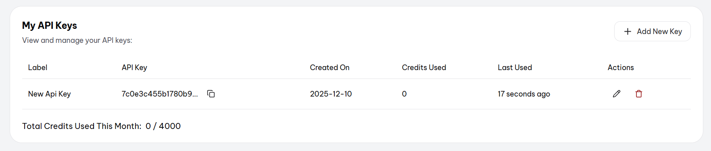

### 1. Instalar o ReactRouter
```npm install react-router-dom```

### 2. React Icons
```npm install react-icons```


consumir a api com as cripto moedas:
1- Url para gerar sua chave (crie sua conta): https://pro.coincap.io/signup

senha: Secreta

2- Com a conta criada acess o painel: https://pro.coincap.io/dashboard

3- Clique em (Add new Key)



4- Só copiar sua API key para usar na url e ai a url fica assim:

> rest.coincap.io/v3/assets

Exempolo de como fica o link: https://rest.coincap.io/v3/assets?limit=10&offset=0&apiKey=COLA_AQUI_SUA_KEY